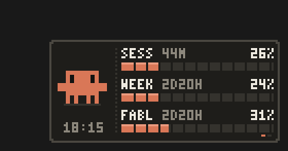
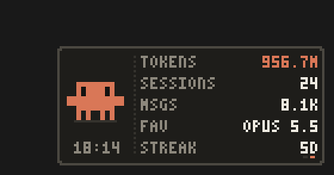

<div align="center">

# 👾 Claude Pixel

**A tiny pixel-art desktop widget that shows your Claude usage limits in real time, with an animated mini Claude.**

[](https://github.com/Tachsakorn/claude-pixel/releases/latest/download/ClaudePixel.exe)


 

</div>

## ⬇️ Download (one click)

1. Download **[ClaudePixel.exe](https://github.com/Tachsakorn/claude-pixel/releases/latest/download/ClaudePixel.exe)** (~30 KB).
2. Double-click it. The widget appears in the bottom-right corner of your screen.

It's a single file with no installer. It runs on the .NET Framework 4 that is already part of Windows 10/11.

> Windows SmartScreen may warn you because the exe isn't code-signed. Click **More info → Run anyway**, or [build it yourself](#-build-from-source) from the source in about 2 seconds.

## ✨ Features

- **Live limits:** session (5h), weekly, and per-model weekly limits such as Fable, each with a % bar and a reset countdown. A bar turns red at 80% or more. The data updates every 60 s.
- **Local stats:** total tokens, sessions, messages, your favourite model and your current streak.
- **Mini Claude** moves on its own: it bobs, blinks, looks around, and walks while it fetches data. It hops and cheers when new data arrives, sweats when you're close to a limit, and shows a `?` when something is wrong.
- **Light:** about **0.07% CPU and 13 MB RAM** on a typical laptop. It animates at about 6 fps on a 112×50 canvas scaled up with nearest-neighbour, so it uses no GPU or web engine.
- Draggable and always on top, with no taskbar or Alt-Tab entry, and it remembers its position.

## 🖱️ Controls

| Action | Result |
|---|---|
| Drag | Move the widget (position is saved) |
| Left-click | Switch between **Limits** and **Stats** |
| Right-click | Refresh now · Size 2x–5x · Always on top · Start with Windows · Exit |

## 🔑 Requirements

The widget reads data that **[Claude Code](https://claude.com/claude-code)** already keeps on your PC:

| Data | Source |
|---|---|
| Live limits | `%USERPROFILE%\.claude\.credentials.json` (your Claude Code login), sent only to `api.anthropic.com` |
| Stats | `%USERPROFILE%\.claude\stats-cache.json` |

If the widget shows **`LOGIN`**, open a terminal and run:

```bash
claude
```

Then type `/login`. From then on the widget refreshes the token by itself.

**Privacy:** it doesn't collect anything. The only network traffic is to Anthropic: the usage endpoint, plus the OAuth token endpoint when the token needs refreshing. Your token never leaves your machine for anywhere else.

## 🛠 Build from source

No SDK or Visual Studio is needed. The script uses the C# compiler that ships with Windows:

```bash
build.cmd
```

This produces `ClaudePixel.exe` next to the source. Everything lives in one file: [`ClaudePixel.cs`](ClaudePixel.cs).

## 🗑 Uninstall

Right-click the widget, untick **Start with Windows**, then click **Exit**. Then delete the exe and `%APPDATA%\ClaudePixel`.

## 🇹🇭 ภาษาไทย

วิดเจ็ตพิกเซลเล็ก ๆ ติดมุมจอ แสดงโควต้า Claude แบบเรียลไทม์ (Session / Week / Fable) และสถิติการใช้งาน พร้อมมินิ Claude ที่ขยับได้ กิน CPU ~0.07% และ RAM ~13 MB

- **ดาวน์โหลด:** [ClaudePixel.exe](https://github.com/Tachsakorn/claude-pixel/releases/latest/download/ClaudePixel.exe) แล้วดับเบิลคลิกได้เลย ไม่ต้องติดตั้ง
- ถ้าขึ้นว่า `LOGIN` ให้เปิดเทอร์มินัล พิมพ์ `claude` แล้วพิมพ์ `/login`
- **คลิกซ้าย** สลับหน้า · **ลาก** เพื่อย้ายตำแหน่ง · **คลิกขวา** เปิดเมนู (ปรับขนาด / เปิดพร้อม Windows / ปิด)

## ⚠️ Disclaimer

This is an unofficial fan project. It is not affiliated with or endorsed by Anthropic. The usage endpoint it reads is not a documented public API and may change at any time. "Claude" is a trademark of Anthropic.

## License

[MIT](LICENSE) © 2026 Tachsakorn
